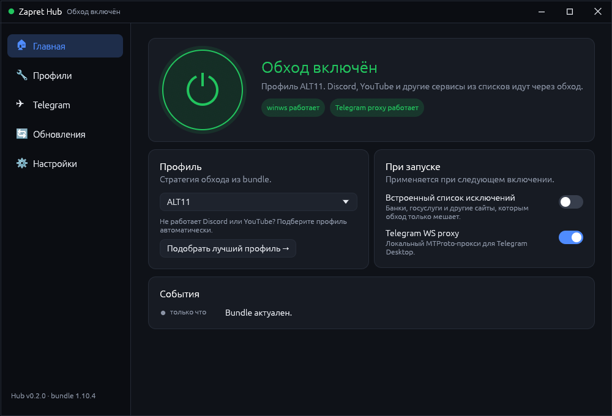
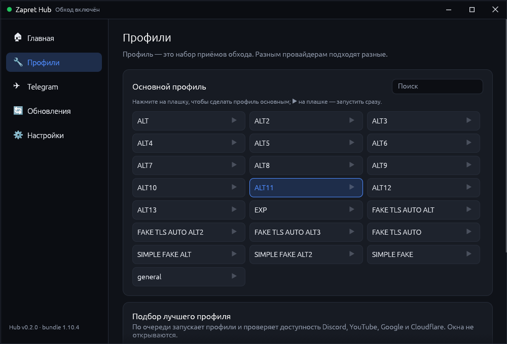
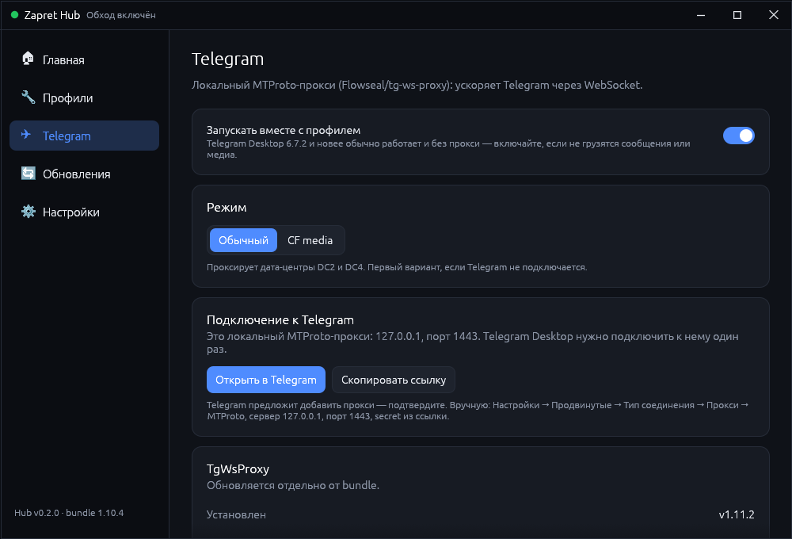
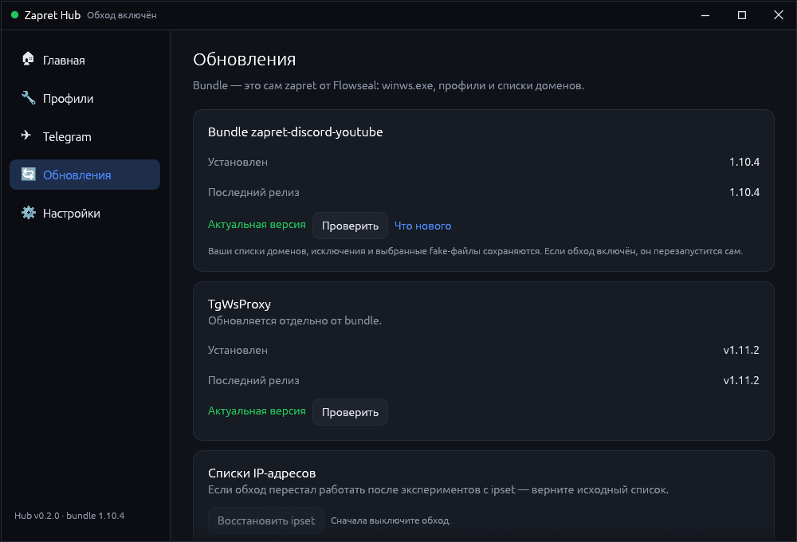
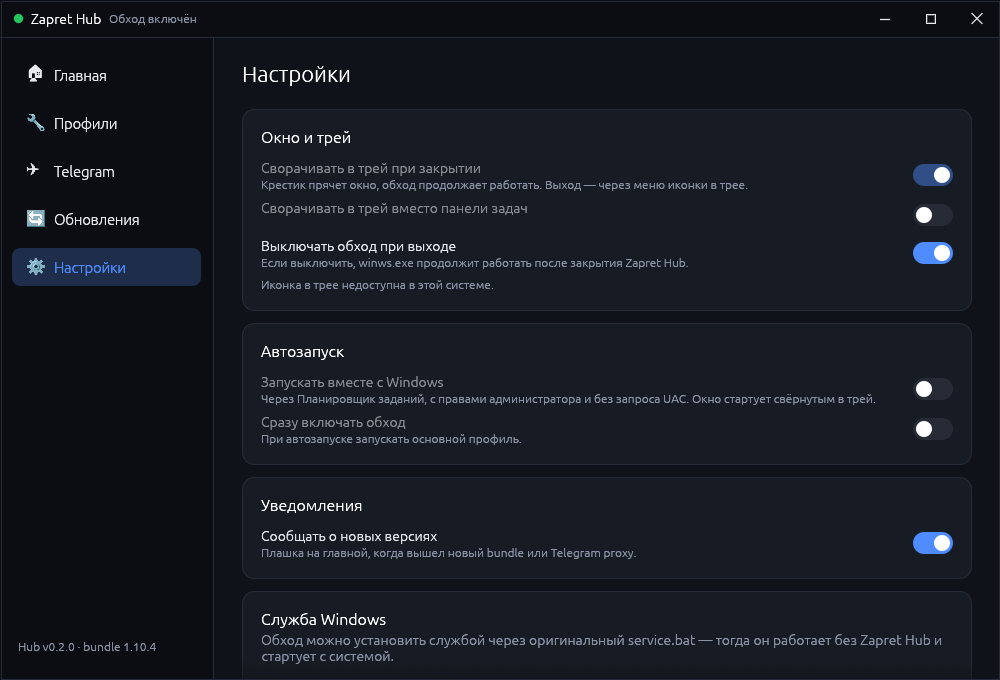

# Zapret Hub

`Zapret Hub` это Windows-приложение-оболочка для готового локального `zapret`-bundle.

Этот репозиторий не реализует сам bypass-движок. Он даёт нативный GUI, упаковку, проверки статуса и более удобное управление уже существующим Windows-набором, в котором есть профили, helper-скрипты, `winws`, `WinDivert` и Telegram proxy.



## Что делает проект

- включает и выключает обход одной кнопкой, живёт в трее
- запускает любой профиль `general*.bat` из bundle и подбирает лучший автоматически
- скачивает и обновляет bundle Flowseal и Telegram WS proxy в один клик
- управляет локальным MTProto-прокси для Telegram (порт 1443): кнопка «Открыть в Telegram» подключает его одним кликом, есть режим `CF media`
- открывает оригинальный `service.bat` и удаляет службу `zapret`
- запускается вместе с Windows (через Планировщик, без UAC) и может сразу включать обход

## Чего проект не делает

- это не замена `zapret`
- это не собственная реализация DPI bypass
- проект не претендует на авторство базового bypass-стека
- он не заменяет оригинальные bundle-скрипты и их сетевую логику

Фактическое bypass-поведение по-прежнему идёт из shipped bundle и его upstream-проектов.

## Как это выглядит после установки

```text
Zapret Hub/
  Zapret Hub.exe
  bundle/
    ...
```

Во время работы приложение сначала ищет `bundle/` рядом с `Zapret Hub.exe`.

## Интерфейс

Собственное окно со своими кнопками свернуть/развернуть/закрыть, плавные переходы между страницами и анимации. Тема следует настройке Windows.

| Профили | Telegram |
| --- | --- |
|  |  |
| **Обновления** | **Настройки** |
|  |  |

## Возможности

- нативный интерфейс на Rust (`egui` / `eframe` 0.37), светлая и тёмная тема по настройке Windows
- собственная шапка окна и анимации; иконка в трее с меню, сворачивание в трей при закрытии, единственный экземпляр приложения
- статус `winws.exe`, `TgWsProxy_windows.exe` и службы `zapret` напрямую через WinAPI, без запуска консольных утилит
- все служебные процессы запускаются скрыто, `winws.exe` из профилей 1.10.x тоже не оставляет окон
- подбор лучшего профиля без PowerShell: обычный HTTP/TLS/ping и глубокий режим DPI 16–20 КБ
- обновление bundle: скачать → остановить обход → заменить → запустить снова; пользовательские списки и fake-файлы сохраняются
- выбор UDP fake-файлов для Discord Voice и GameFilter
- сборка под Windows с Linux, портативный архив и установщик Inno Setup

## Telegram

Telegram WS proxy (Flowseal) — это локальный **MTProto**-прокси на `127.0.0.1:1443`. На странице «Telegram» включите «Запускать вместе с профилем», включите обход и нажмите «Открыть в Telegram» (или «Скопировать ссылку» и откройте её в Telegram). Прокси добавится один раз, дальше всё работает само. Секрет прокси создаёт он сам при первом запуске и хранится в `%APPDATA%\TgWsProxy\config.json`.

Zapret Hub меняет в этом файле только свои ключи (порт, список DC, режим CF), остальные настройки прокси не трогает.

## Telegram CF media

Если в Telegram работают сообщения, но не грузятся фотографии, видео, реакции или часть файлов, включите режим `CF media` в настройках Telegram proxy.

Для этого нужен свой домен, подключенный к Cloudflare. Общий домен в публичной сборке не используется: он быстро упрётся в лимиты и будет нестабильным для пользователей.

Короткий путь:

1. Подключите свой домен к Cloudflare в режиме `Full setup`.
2. В Cloudflare включите `SSL/TLS -> Flexible`.
3. Добавьте proxied DNS-записи `kws1`, `kws2`, `kws3`, `kws4`, `kws5`, `kws203`.
4. В Zapret Hub откройте настройки Telegram proxy, включите `CF media` и впишите свой домен.

Подробная инструкция с точными DNS-записями и проверками: [docs/TELEGRAM_CF_MEDIA.md](docs/TELEGRAM_CF_MEDIA.md).

## VRChat preset

Zapret Hub automatically adds a managed VRChat block to `lists/list-general-user.txt` whenever a profile starts. The preset covers the main VRChat game endpoints, CDN hostnames, and asset hosts used for login, API requests, worlds, and avatars.

The preset intentionally does not add broad Cloudflare, AWS, or Photon IP ranges to `ipset-all.txt`. Those ranges are shared and change often, so the safer v1 behavior is domain-only hostlist management. UDP realtime paths can still depend on the user's ISP and the current upstream zapret strategy.

## Структура репозитория

```text
src/
  main.rs            запуск, единственный экземпляр, CLI --stage-bundle
  platform.rs        Win32: мьютекс, сигнал «показать окно», MessageBox
  tray.rs            иконка и меню в трее
  app/
    mod.rs           состояние, фоновые задачи, логика окна и трея
    views.rs         страницы интерфейса
    theme.rs         цвета, стили и собственные виджеты
  core/
    bundle_update.rs скачивание и установка bundle
    github.rs        релизы GitHub, загрузка с прогрессом, SHA-256
    profile_test.rs  подбор профиля
    status.rs        процессы и службы через WinAPI
    ...
  zapret/
    bundle.rs        запуск и остановка профилей, Telegram proxy, списки
    fakes.rs         UDP fake-файлы
packaging/
  build-windows.sh   сборка под Windows с Linux + портативный zip
  build-installer.ps1, stage-release.ps1   сборка установщика на Windows
installer/zapret-hub.iss
```

## Сборка под Windows с Linux (Ubuntu)

Один раз:

```bash
curl --proto '=https' --tlsv1.2 -sSf https://sh.rustup.rs | sh   # Rust 1.95+
rustup target add x86_64-pc-windows-gnu
sudo apt install mingw-w64
```

Сборка:

```bash
packaging/build-windows.sh                  # последний bundle Flowseal
BUNDLE_TAG=1.10.4 packaging/build-windows.sh  # закрепить версию bundle
```

Результат:

- `dist/stage/Zapret Hub.exe` и рядом `dist/stage/bundle/`
- `dist/portable/zapret-hub-<версия>-portable.zip` — распаковать и запустить, установка не нужна

Тесты и проверки запускаются на Linux как обычно: `cargo test`, `cargo clippy --target x86_64-pc-windows-gnu`. Тест полного цикла обновления против живого GitHub: `cargo test -- --ignored`.

## Сборка установщика на Windows

Нужны Rust и Inno Setup 6/7:

```powershell
powershell -ExecutionPolicy Bypass -File .\packaging\build-installer.ps1                 # последний bundle
powershell -ExecutionPolicy Bypass -File .\packaging\build-installer.ps1 -BundleTag 1.10.4
```

Результат: `dist\installer\zapret-hub-setup-<версия>.exe` и `dist\installer\latest.json`.

## Установка и обновления

- распространять нужно инсталлер, а не только `.exe`
- новый инсталлер обновляет существующую установку поверх старой
- при обновлении сохраняются пользовательские general/exclude/ipset-exclude списки, оба `ACTIVE_*_UDP.bin`, состояние Game Filter и диагностические логи
- `AppId` в Inno Setup должен оставаться тем же
- перед релизом нужно повышать `version` в `Cargo.toml`

Сейчас модель обновления installer-based. `latest.json` уже генерируется под будущую проверку обновлений, но реальная доставка идёт через setup-файл.

## Credits и upstream-проекты

Этот репозиторий является оболочкой поверх внешних инструментов и bundle-логики. Основные проекты, на которые он опирается:

- `zapret` от bol-van: [github.com/bol-van/zapret](https://github.com/bol-van/zapret)
- lineage Windows-bundle, с которым здесь идёт работа: [github.com/Flowseal/zapret-discord-youtube](https://github.com/Flowseal/zapret-discord-youtube)
- Telegram WS proxy из этого же набора: [github.com/Flowseal/tg-ws-proxy](https://github.com/Flowseal/tg-ws-proxy)
- `WinDivert`: [reqrypt.org/windivert.html](https://reqrypt.org/windivert.html)
- Telegram Desktop: [github.com/telegramdesktop/tdesktop](https://github.com/telegramdesktop/tdesktop)
- `egui`: [github.com/emilk/egui](https://github.com/emilk/egui)
- `eframe`: [github.com/emilk/egui/tree/master/crates/eframe](https://github.com/emilk/egui/tree/master/crates/eframe)
- Inno Setup: [jrsoftware.org/isinfo.php](https://jrsoftware.org/isinfo.php)

## Дополнительно

- архитектурные заметки: [ARCHITECTURE.md](docs/ARCHITECTURE.md)
- release flow: [RELEASE.md](docs/RELEASE.md)
- настройка Telegram `CF media`: [TELEGRAM_CF_MEDIA.md](docs/TELEGRAM_CF_MEDIA.md)

Если форкать или распространять это приложение дальше, лучше сохранять upstream credits. GUI и packaging layer здесь наши, но базовый bypass-стек не наш.
